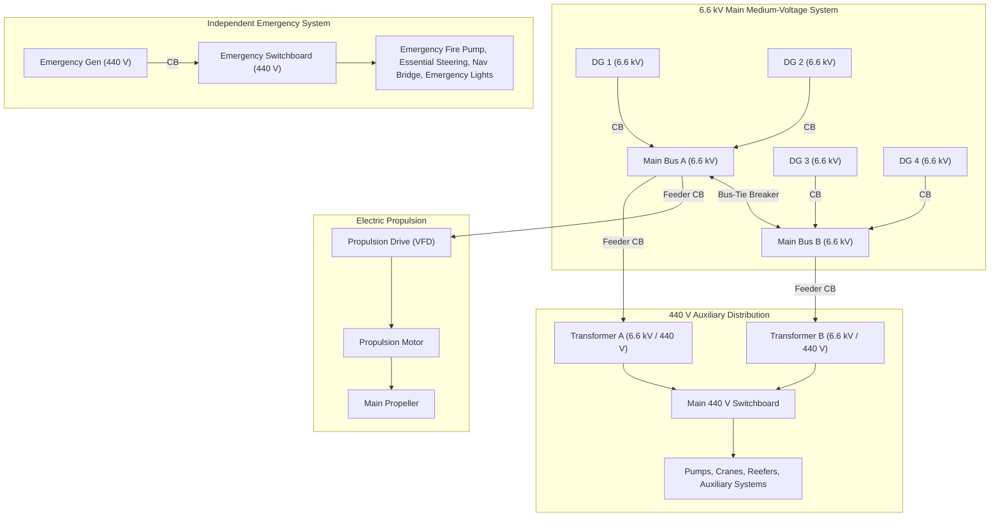

# Marine Power System Simulator · V1

[](https://vitejs.dev/)
[](https://www.typescriptlang.org/)
[](https://threejs.org/)

An interactive, browser-based 3D educational simulator modeling electrical power generation, medium-voltage distribution, and propulsion systems aboard a **generic electric-propulsion container vessel**.

---

## ⚓ Overview

The **Marine Power System Simulator** teaches marine electrical engineering fundamentals through interactive 3D spatial visualization and real-time schematic power-flow analysis. Students and engineers can start/stop generators, open/close circuit breakers, inspect exploded equipment models, and observe how power routes dynamically from sources to consumers under normal and emergency operating conditions.

> [!NOTE]
> This simulator is an educational connectivity model designed for teaching principles of marine power distribution and isolation. It is not an engineering design calculation or classification tool.

---

## ✨ Key Features

### 1. Interactive 3D Vessel View
* **Elevated Freeboard & Seaworthy Hull Proportion**: Lowered waterline (`-1.25`) and raised topsides sheer coaming and forecastle deck, ensuring realistic freeboard height well above sea waves.
* **Hydrodynamic Taylor/Nabla Bulbous Bow**: Organically lofted continuous bulbous bow emerging seamlessly from the lower forefoot and keel line, eliminating faceted step-cuts and featuring a smooth raked stem.
* **Detailed Forecastle & Foredeck Architecture**: Raised forecastle deck with sheer rise, solid plated steel bulwarks with cap rail, heavy-duty V-shaped green water breakwater, twin anchor windlasses/mooring winches, chain pipes, recessed hawse pipes with cast stockless bower anchors, mooring bollards, and forward jackstaff.
* **Athwartships Thruster Tunnels**: Structural transverse bow thruster tube with reinforced collar rims and protective vertical debris grates.
* **Active Propeller & Thruster Animations**: Real-time rotating propeller blades when the propulsion motor circuit is closed/energized, and spinning bronze impeller for the bow thruster when its feeder breaker is closed.
* **Animated Translucent Sea**: Dynamic flowing sea surface at the waterline with wave swell displacement, wave crest drift, and a cutout hugging the vessel hull for an authentic floating visual illusion.
* **Detailed Slewing Deck Crane**: High-fidelity cargo crane model including a flanged pedestal, slewing ring, machinery house, operator cab with glazing, 7-panel lattice boom with diagonal bracing, twin hydraulic luffing rams, sheaves, and hook block.
* **Interactive Reefer Container & Power Flow**: Active 40-foot refrigerated container in the cargo bay connected via a socket feeder cable to the reefer distribution board. Features an animated spinning condenser fan and dual-state power indicator light (green = powered / red = isolated).
* **Realistic Equipment Placement**: Exact positioning of 4 Diesel Generators (DG 1–4), 6.6 kV Main Switchboards (Sections A & B), propulsion drive/motor, transformers, pumps, and deck equipment.
* **Camera Controls**: Orbit, pan, zoom, **Reset view**, and **Focus item** to zoom in on any selected piece of machinery in place.
* **Visibility Toggles**: Toggle translucent outer hull shell and machinery 3D labels on/off.

### 2. "Inside the Equipment" Exploded View (with Fullscreen Enlarge)
* **Detailed Procedural Models**: Inspect internal mechanical and electrical assemblies for key equipment:
  * **Diesel Generator — 22 selectable assemblies**: Marine green V12 engine, wet liners, pistons and connecting rods, crankshaft, heads, valves, rocker covers, turbocharger, charge-air cooler, fuel piping, oil and cooling auxiliaries, flywheel, coupling, and a detailed alternator.
  * **Vacuum Circuit Breaker (VCB) — 15 selectable assemblies**: Three vacuum poles, fixed/moving contacts, bellows, primary disconnects, insulating pushrods, contact-pressure springs, closing/opening springs, charging motor, releases, secondary plug, front cover and withdrawable truck.
  * **Main Switchboards — 14 selectable assemblies each**: Three cubicles with analog meters, relays, mimic lines, controls and ventilation. Exploded views expose busbars, supports, switching units, current transformers, cable terminations, earth bar and control wiring. The 6.6 kV board uses VCBs; the LV board illustrates ACBs and moulded-case feeders.
  * **Switchboard Enclosures, Transformers, Thrusters, Drives, and Pumps**.
* **Expandable Modal**: Click **⤢ Enlarge** to open an expansive inspection dialog with a large 3D canvas and an interactive components list with descriptive engineering explanations. Close anytime via **✕ Close**, **Esc**, or clicking the backdrop.
* **Exploded Animation**: Smoothly toggle between assembled and exploded configurations (**↗ Explode view** / **↙ Assemble view**).
* **Part inspection**: Select a numbered part name or click the geometry to highlight it and read its description. **Focus part** isolates and frames that assembly; selecting another name continues the isolated inspection. **Fit all** restores the complete model. Explosion offsets are authored per assembly, and the camera fits the assembled or exploded bounds.
* **Reference scope**: Equipment is modeled procedurally from the supplied visual references, with generic illustrative proportions. The generator is a four-stroke generating set driving an alternator. Instrument faces are illustrative, and exploded positions are a teaching arrangement rather than a maintenance sequence.

### 3. Synchronized Single-Line Diagram (SLD)
* **Dynamic Electrical Topology**: Full SVG single-line schematic displaying medium-voltage (6.6 kV) generation, 440 V distribution, 220 V consumer services, and isolated 440 V emergency distribution.
* **Animated Power Flow**: Energized paths pulse with active flow indicators, de-energized lines display dotted standby states, and tripped/opened breakers show visible isolation gaps.
* **Interactive Breaker Switching**: Click any breaker directly on the schematic or from the control panel to open/close paths.

### 4. Educational Scenarios & Guided Lessons
Preconfigured guided learning scenarios:
1. **01 · Energize the main bus**: Baseline setup with DG 1 running, generator breaker closed, and bus tie closed powering both 6.6 kV sections.
2. **02 · Supply propulsion**: Trace power from DG 1 through Bus A, propulsion feeder breaker, variable frequency drive (VFD), electric propulsion motor, and main propeller.
3. **03 · Open the bus tie**: Split-bus operation demonstrating blackout of Bus B when the tie breaker opens, followed by independent restoration using DG 3.
4. **04 · Restore essentials**: Simulates main plant failure and startup of the independent emergency diesel generator (EDG) supplying the emergency switchboard and critical life-safety loads (emergency fire pump, steering, navigation, emergency lighting).

### 5. Crisp Modern Light Theme
* Clear, high-contrast maritime color palette optimized for presentations, educational classrooms, and documentation readability.

---

## ⚡ Electrical System Architecture



---

## 📁 Repository Structure

```
.
├── .github/workflows/
│   └── deploy.yml          # GitHub Actions automated Pages build and deploy
├── public/
│   ├── assemblies/         # Standalone 3D explodable CAD inspection web views
│   ├── blender-hull-V6.glb # Translucent multi-deck container ship hull 3D model
│   └── marine_propeller_assembly.glb # Detailed 3D marine propeller and stern tube assembly
├── scripts/
│   ├── check-layout.mjs    # Automated 3D boundary, collision, and shaft clearance test
│   └── shot.mjs            # Automated headless screenshot verification utility
├── src/
│   ├── main.ts             # Application entry point, UI binding, event handlers
│   ├── models.ts           # 3D procedural exploded equipment models and part metadata
│   ├── equipment-models.ts # Reference-inspired genset, VCB and switchboard assemblies
│   ├── network.ts          # Electrical connectivity solver, equipment registry, and scenarios
│   ├── propeller-assembly.ts # 3D exploded propeller & stern tube loader and animation controller
│   ├── scene.ts            # Three.js 3D vessel and exploded-view camera/renderer controllers
│   ├── style.css           # Light-theme styles, responsive layout, and modal controls
│   ├── vessel.ts           # Detailed 3D vessel geometry (hull, decks, container bays, bridge)
│   └── vessel-layout.ts    # Coordinates, dimensions, and physical compartments for all equipment
├── index.html              # Main HTML entry point
├── package.json            # Project dependencies and script declarations
├── tsconfig.json           # TypeScript configuration
└── vite.config.ts          # Vite configuration with relative base path support
```

---

## 🛠️ Development & Local Setup

### Prerequisites
* **Node.js**: v20.19.0 or v22.12.0+
* **npm**: v10+

### Installation & Run
1. Clone the repository:
   ```bash
   git clone https://github.com/johnray-d/marine-powersystem-project1.git
   cd marine-powersystem-project1
   ```
2. Install dependencies:
   ```bash
   npm install
   ```
3. Start local development server:
   ```bash
   npm run dev
   ```
   Open **http://localhost:5173/** in your browser.

4. Verify 3D layout bounds and equipment clearances:
   ```bash
   npm run check:layout
   ```

5. Build for production:
   ```bash
   npm run build
   npm run preview
   ```

---

## 🚀 Deployment to GitHub Pages

The project includes an automated deployment workflow via [GitHub Actions](.github/workflows/deploy.yml).

1. In your GitHub repository, navigate to **Settings → Pages**.
2. Under **Build and deployment → Source**, select **GitHub Actions**.
3. Any push to the `main` branch will automatically compile and deploy the simulator to GitHub Pages.

---

## 📜 License

Created for educational and training purposes.

## Equipment terminology references

The supplied images guide appearance. These manufacturer resources support the component terminology and operating principles:

* [Wärtsilä engine auxiliary systems](https://www.wartsila.com/marine/products/engines-and-generating-sets/generating-sets/wartsila-engines-auxiliary-systems) — lubrication, cooling and charge-air equipment.
* [Wärtsilä pressure charging](https://www.wartsila.com/encyclopedia/term/pressure-charging) — exhaust-driven turbocharging.
* [ABB VD4 vacuum circuit breakers](https://www.abb.com/gb/en/areas/electrification/medium-voltage/grid-components/primary-vacuum-circuit-breakers/vd4-evo) — vacuum poles and spring-operated mechanisms.
* [ABB UniGear ZS1](https://www.abb.com/global/en/areas/electrification/medium-voltage/switchgear/air-insulated/unigear/zs1) — metal-enclosed medium-voltage switchgear.
